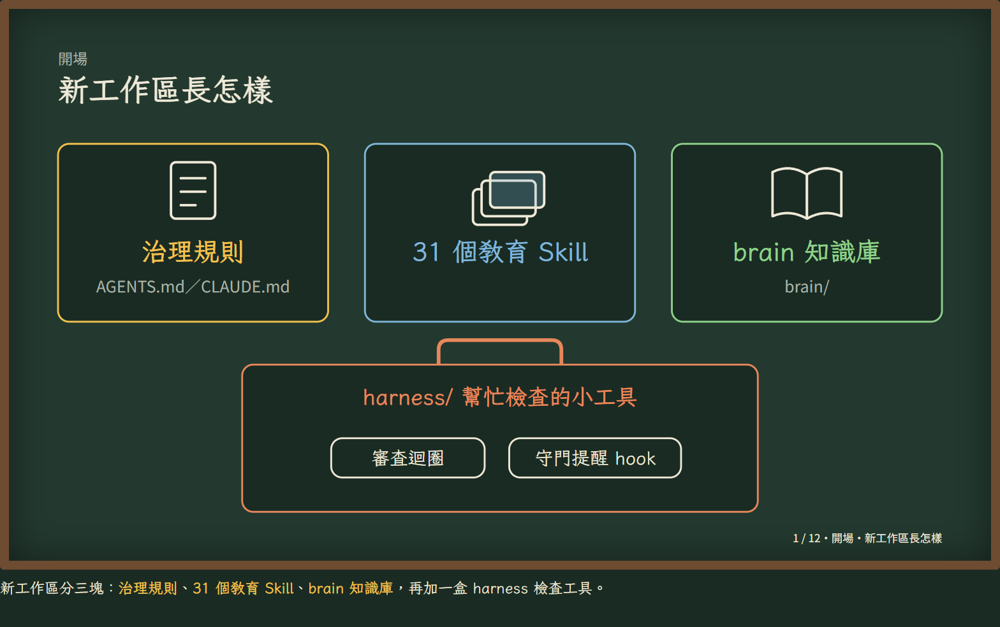
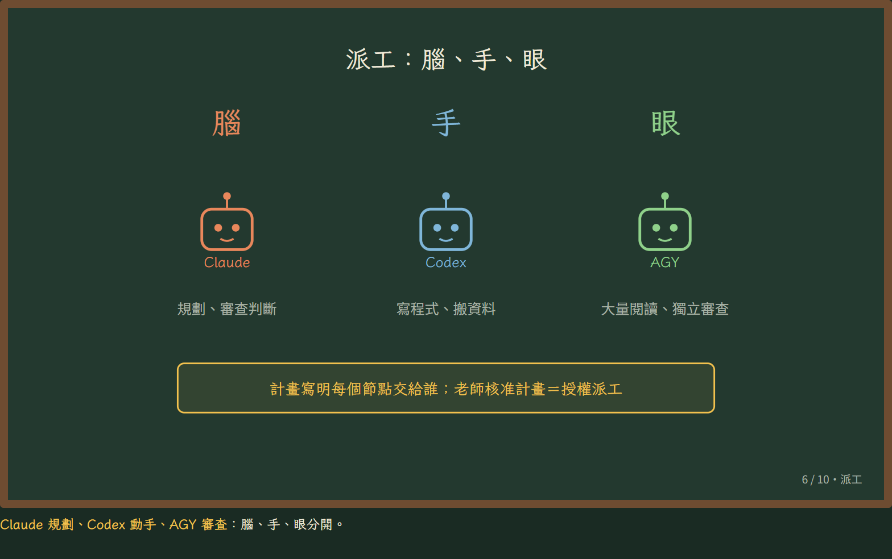
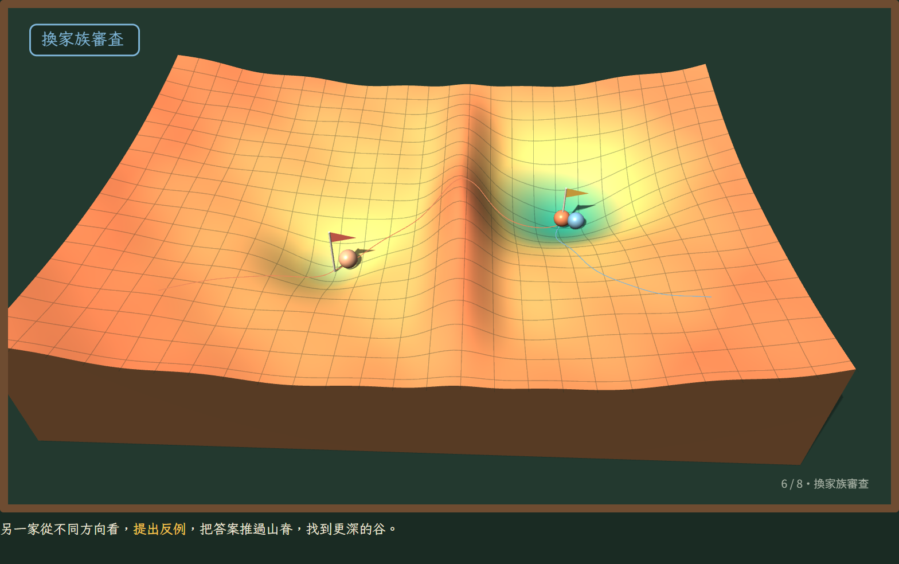
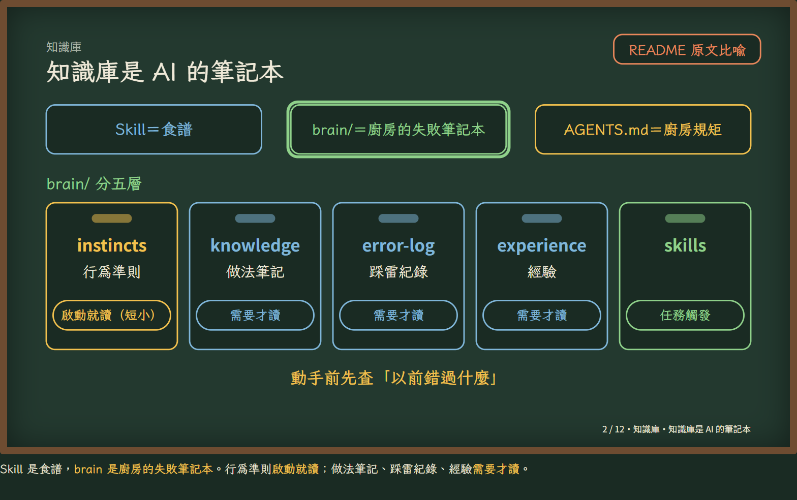
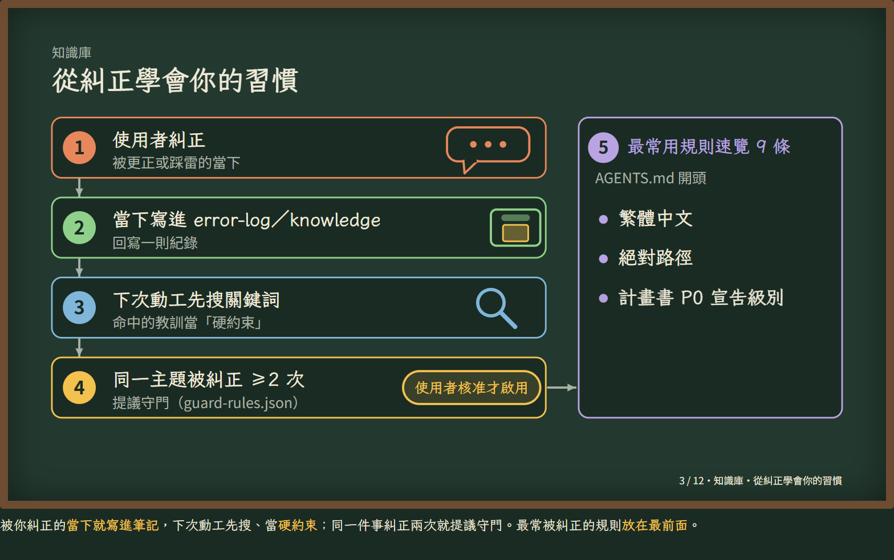
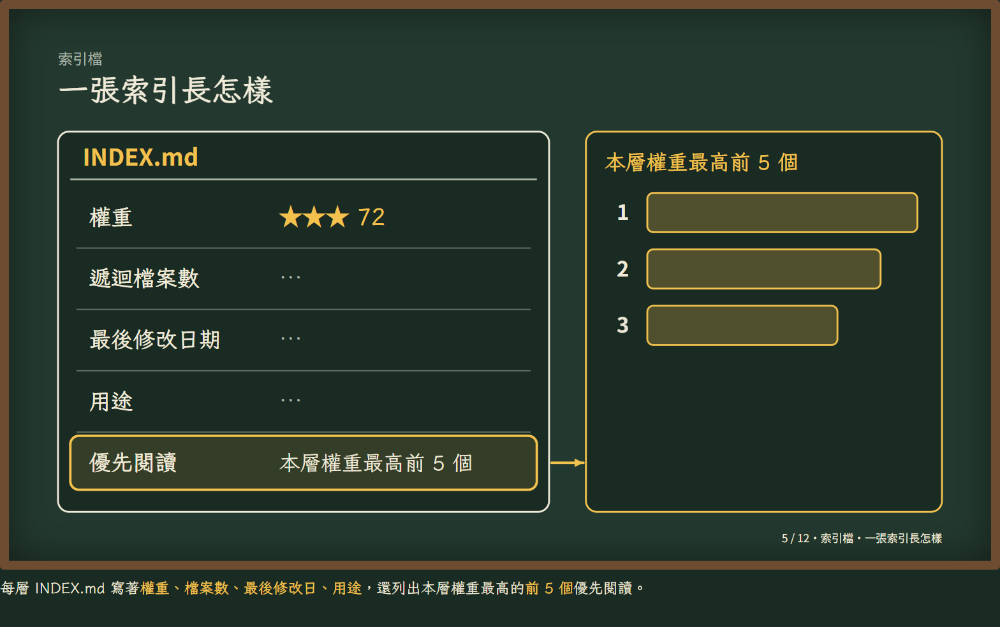
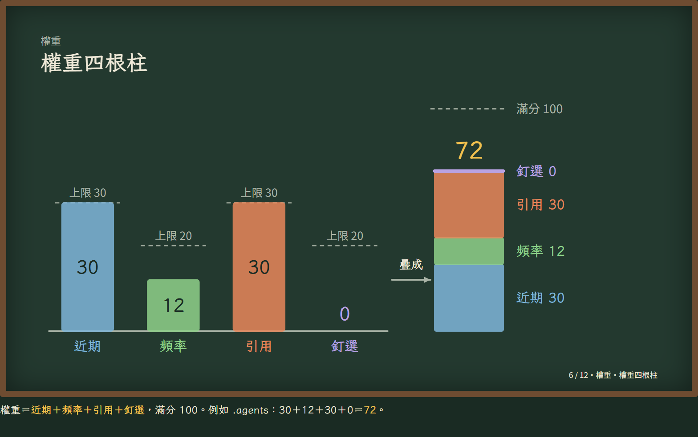
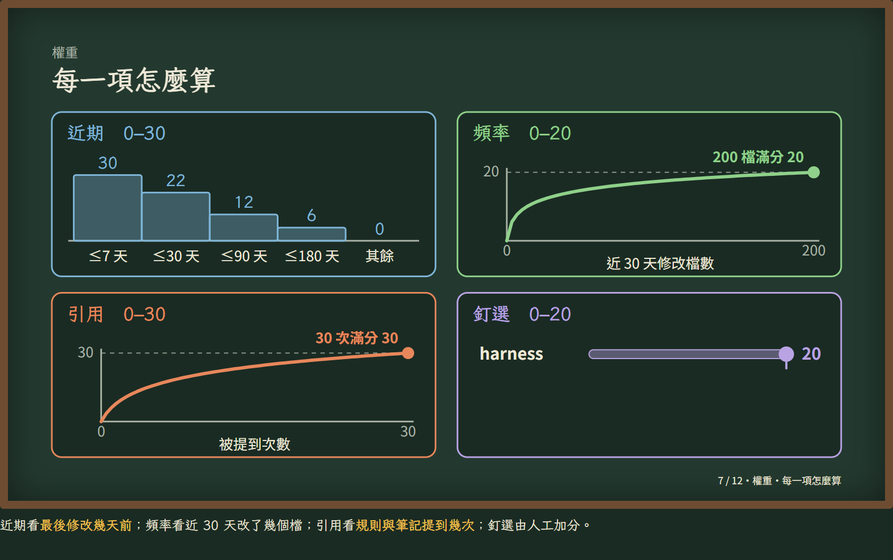
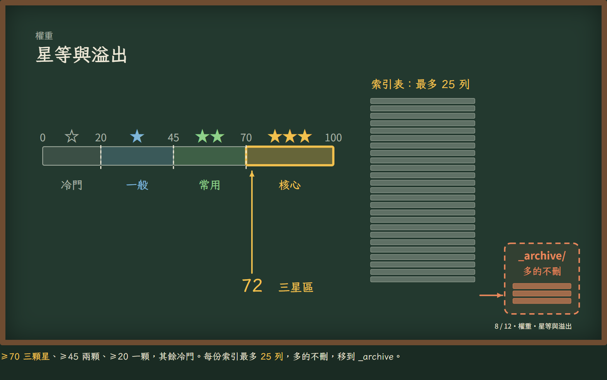

# eduHarness：本機可插拔治理 Harness＋教育用 Skill 與知識庫

## 這是什麼

這是一套**只在自己電腦上跑**的 AI 工作規範與工具組，給用 AI 代理（Claude Code、Codex 等）做教育相關工作的老師與開發者參考。它分成三塊：

- **治理規則**：`AGENTS.md`（各家代理共用的工作規則）與 `CLAUDE.md`（Claude 端補充）。重點是「使用者說了算」：非瑣碎的任務先寫計畫、列出每一步誰做、怎麼驗證，使用者核准後才動手；作者不能審自己的成果。
- **教育用 Skill**：教案、命題、臆測教學、教材轉遊戲、教學動畫、圖解等 31 個 Skill，每個 Skill 是一份「什麼時候用、怎麼做、交付什麼」的工作說明。
- **知識庫**：`brain/` 收錄踩雷紀錄與做法筆記，讓代理動手前先查「以前錯過什麼」。

打個比方：Skill 是食譜，`brain/` 是廚房的失敗筆記本，`AGENTS.md` 是廚房規矩，`harness/` 是幫忙檢查的小工具。



> 本文的圖片截自作者教學網站上的三支解說動畫：「新工作區怎麼運作」、「本工作區的 Harness」與「為什麼要換家審查」。

## 三個 AI 模型怎麼分工：腦、手、眼



這套規則把工作交給三個不同的 AI，各做自己最適合的事：

| 角色 | 由誰擔任 | 負責什麼 |
|---|---|---|
| **腦** | Claude（主對話） | 理解需求、寫計畫書、設計架構、整合結果、做最後判斷；需求模糊或要取捨時一律留在這裡 |
| **手** | Codex | 粗工：找資料、寫程式、搬檔案、照完整規格重複實作 |
| **眼** | AGY（Antigravity CLI，指定非 Claude 家族的模型） | 一次讀大量內容、做獨立審查；結果只當參考，不能取代使用者的決定 |

老師（使用者）不在這三者之內，而是在它們之上：計畫書寫明每個步驟交給誰、用哪個模型，**老師核准計畫才等於授權開工**。碰到範圍改變、不可逆或對外的動作（推送、發布、刪除），一律停下來問老師。

### 為什麼要這樣分

1. **讓貴的腦袋只做需要判斷的事。** 規劃、取捨、整合需要最完整的上下文和最強的推理，留給主對話；找資料、寫重複程式這類規格清楚的粗工，交給成本較低的代理，省下主對話的額度與上下文空間。好比主廚負責設計菜單和試味道，切菜備料交給助手。
2. **誰做的，不由自己審。** 同一家族的模型，訓練資料和習慣相近，容易犯同樣的錯、一起說「沒問題」。換一個家族來看，比較容易提出反例、看見盲點。這不是誰比較聰明，而是**錯法不一樣**，降低一起看走眼的機會。所以作者是 Claude 時，審查一律交給 AGY 並指定非 Claude 的模型，收據要記下實際用了哪個模型。
3. **安全相關的工作另外把關。** 牽涉登入、金鑰、加密、輸入驗證的工作不交給一般粗工代理；執行和審查也必須是不同的模型。
4. **缺一個也不會卡住。** 某個代理不能用時，由主對話接手並記下「原本要誰做、實際誰做」的差異，但不能藉機擴大可以改動的範圍。



## 用知識庫記住你的習慣

AI 每開一次新對話都會「失憶」。這套做法用 `brain/` 當 AI 的筆記本，讓它記住你的習慣和以前踩過的雷：



| 資料夾 | 放什麼 | 什麼時候讀 |
|---|---|---|
| `brain/instincts/` | 行為準則（短小） | 每次啟動就讀 |
| `brain/knowledge/` | 做法筆記 | 需要才讀 |
| `brain/error-log/` | 踩雷紀錄 | 需要才讀 |
| `brain/experience/` | 回顧與經驗 | 需要才讀 |
| `brain/skills/` | 31 個 Skill | 任務符合時觸發 |

習慣是這樣「學」起來的：



1. **被糾正的當下就寫下來**：你更正 AI 或它踩到雷時，立刻寫一則紀錄（錯誤寫進 `brain/error-log/`，做法寫進 `brain/knowledge/`），寫明原因與下次怎麼做。
2. **動工前先搜**：下一個任務開始前，AI 先用關鍵詞搜知識庫；搜到的教訓當成**必須遵守的限制**。
3. **開口就提醒**：每次送出提問，hook（`harness/hooks/inject-lessons.mjs`）自動附上審查提醒和**最多 3 則**相關教訓，不靠 AI 自己記得去翻。
4. **同一件事被糾正兩次，就升級成守門規則**：AI 會停下來回頭整理原則，並提議加一條提醒型守門；你核准了才會啟用。
5. **最常被糾正的規則放在最前面**：`AGENTS.md` 開頭的「最常用規則速覽」就是這樣長出來的，例如繁體中文、給絕對路徑、計畫書第一步先宣告級別。

## 索引檔與內容權重：用進廢退

筆記越寫越多，AI 也會找不到。所以每一層資料夾都有一張 `INDEX.md` 當地圖：AI 先讀最上層的總索引，照「優先閱讀」和 ★ 權重往下找，不用每次把整個工作區翻一遍。



每張 `INDEX.md` 寫著這一層的**權重、遞迴檔案數、最後修改日期、用途**，並列出本層權重最高的**前 5 個**當「優先閱讀」。

### 權重怎麼算

權重滿分 100，由四根柱子相加：



| 項目 | 分數範圍 | 怎麼算 |
|---|---|---|
| 近期 | 0–30 | 最後修改在 7 天內 30 分、30 天內 22 分、90 天內 12 分、180 天內 6 分，更久 0 分 |
| 頻率 | 0–20 | 近 30 天修改了幾個檔案，越多越高，約 200 個檔案就滿分 |
| 引用 | 0–30 | 被規則與筆記提到幾次，越多越高，約 30 次就滿分 |
| 釘選 | 0–20 | 由人工加分，例如把 `harness/` 釘選為 20 分 |

例如 `.agents` 資料夾：近期 30＋頻率 12＋引用 30＋釘選 0＝**72 分**。



分數換成星等：**70 分以上三顆星（核心）**、45 分以上兩顆（常用）、20 分以上一顆（一般），其餘是冷門。每張索引最多 25 列，**多出來的不刪除，而是移到 `_archive/`**。



### 為什麼說是「神經可塑性」

這個設計借用了大腦學習的道理（是比喻與設計靈感，不是說 AI 真的有神經元）：

- **用進廢退**：大腦裡常用的神經連結會變強，不用的會被修剪。索引也一樣，最近常改、常被提到的地方分數升高、排到前面；很久沒碰的分數自然下降，掉成冷門。重算索引時，排序就跟著你實際的使用習慣改變。
- **修剪但不遺忘**：大腦修剪的是雜訊，不是把記憶全部抹掉。索引超過 25 列時，冷門的移到 `_archive/`，不刪除，需要時還找得到；讓「熱門路徑」保持清爽，AI 第一眼看到的都是最相關的內容。
- **好線索讓回想自動化**：索引就是提示線索。開工先看索引變成固定儀式，AI 就能直接走到對的地方。
- **錯誤驅動學習**：被糾正一次就寫一筆紀錄，等於替下次重新接一條線；同樣的錯不用再犯第二次。
- **重複的路徑越走越順**：常做的事固定入口、固定命名、只留一份正本（不做同義副本）；反覆的多步流程升級成具名的 Skill。

完整說明見 [`brain/knowledge/workspace-neuroplasticity-operating-manual.md`](brain/knowledge/workspace-neuroplasticity-operating-manual.md)（操作手冊）與 [`brain/instincts/neuroplasticity-operating-rules.md`](brain/instincts/neuroplasticity-operating-rules.md)（啟動就讀的短版提醒）。

> 注意：作者本人的索引檔（`INDEX.md` 與 `_archive/`）描述的是自己的私人工作區，放在 `private/` 裡，**不在這個 repo**；這裡公開的是做法與規則。你可以照上面的欄位與算法，替自己的工作區建一套。

## 目錄導覽

| 位置 | 內容 |
|---|---|
| `AGENTS.md` | 工作規則正本（各家代理共用） |
| `CLAUDE.md` | Claude 端補充規則 |
| `brain/skills/` | 31 個 Skill；清單見 [`brain/skills/README.md`](brain/skills/README.md) |
| `brain/knowledge/`、`brain/error-log/`、`brain/instincts/`、`brain/experience/` | 做法筆記、踩雷紀錄、行為準則、回顧 |
| `config/` | 網站與服務設定的公開範本（`sites.example.json`）與說明 |
| `harness/` | 審查迴圈（review-loop）、AGY 呼叫元件、守門提醒 hook、公開掃描器與測試 |
| `tools/claude-cli/` | Windows 雙擊開 Claude Code CLI 的啟動檔（可選訂閱或 API 金鑰計費），說明見 [`tools/claude-cli/README.md`](tools/claude-cli/README.md) |
| `.claude/` | Claude Code 專案設定（公開安全的網域允許清單、守門提醒 hook） |

## 快速開始

需要 Node.js 20.11 以上，不需要安裝任何套件。

1. 跑測試：

   ```text
   npm test
   ```

2. 公開掃描（分享或提交前檢查有沒有私人資料外洩）：

   ```text
   npm run scan:public
   ```

   掃描器需要你自己的禁止字串清單才會執行（沒有就拒絕執行），做法見下方「公開與私人內容怎麼分」。

3. 送外部審查（review-loop）：

   ```text
   node harness/cli/review-loop.mjs <本任務設定檔.json>
   ```

   設定檔寫明審查目標、要審的檔案（每包最多 30 個）、檢查項目與審查模型。審查由 AGY（Antigravity CLI）執行，需要先在本機裝好並能用 `--version` 跑起來；作者是 Claude 時，審查模型必須指定非 Claude 家族。只想檢查設定檔可加 `--preflight-only`。

## 公開與私人內容怎麼分

- 私人資料（個人規則、本機網址與埠號、帳號、禁止字串清單）一律放在 `private/` 資料夾或 `*.local.*` 檔，兩者都被 `.gitignore` 排除，**不在這個 repo 裡**。clone 下來沒有 `private/` 是正常的。
- 自建私人區：
  1. 把 `harness/tools/forbidden-strings.example.json` 複製成 `private/scan/forbidden-strings.local.json`，把裡面的假值換成你自己不想外洩的字串（帳號、學校、內部代號等），再跑：

     ```text
     node harness/tools/scan-public.mjs --self-test
     ```

  2. 把 `config/sites.example.json` 複製成 `private/config/sites.local.json`，填入你自己的網址、埠號等值。Skill 只讀設定鍵，讀不到值會停下來問你，不會亂猜。
- 金鑰、token、密碼**不寫進任何檔案**，只放在使用者層的環境變數。
- 完整規則見 `AGENTS.md`「公開／私人切割規範」。

## Skill 清單

所有 Skill 的名稱、用途與是否需要設定，見 [`brain/skills/README.md`](brain/skills/README.md)。目前 Skill 放在 `brain/skills/`，尚未自動投影到 `.claude/skills`，要用時請手動複製到你的代理會讀的位置。

## 授權

- 程式碼：MIT，見 [`LICENSE`](LICENSE)。
- 文件（規則、知識庫、Skill 說明等）：CC BY 4.0，見 [`LICENSE-DOCS.md`](LICENSE-DOCS.md)。
- 檔案內標示來自第三方上游專案的內容，依該上游原本的授權與署名要求。
