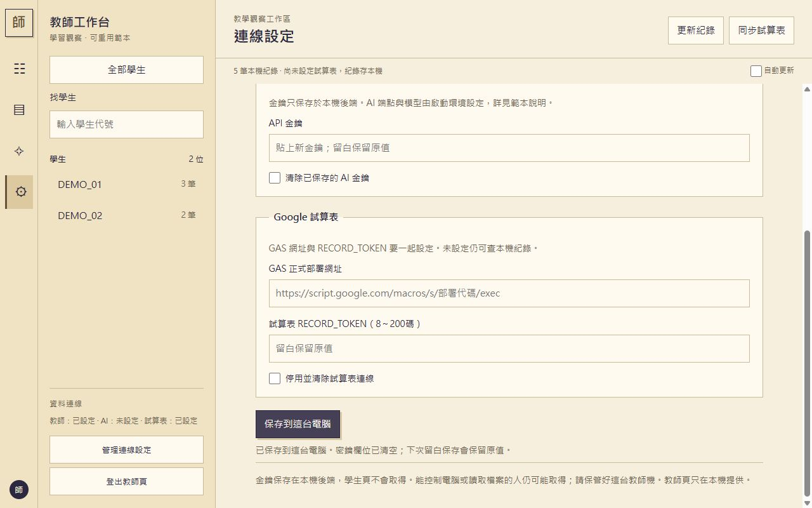
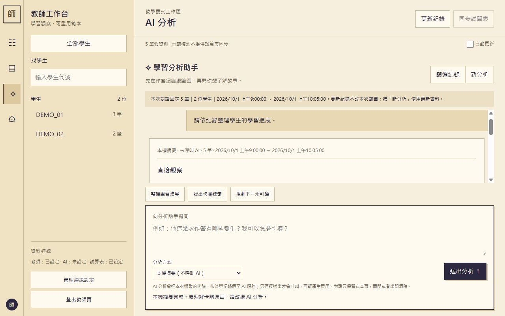
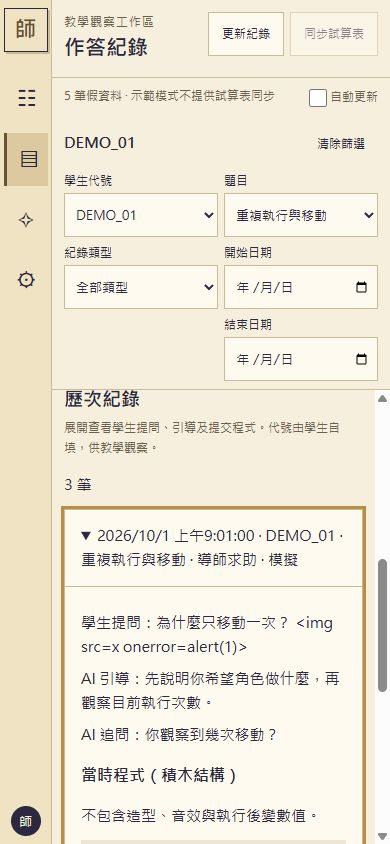

# 範例圖片與來源

以下圖片都是公開範本以**假資料**（DEMO_01、DEMO_02）實測的畫面，不含真實學生、金鑰或 token。

公開範本的8碼設定介面：

公開範本本機摘要（分成直接觀察、待確認推測、教學建議與資料限制；引用按鈕能回到原始作答）：

窄版保留左側導覽，學生清單由按鈕開關。此圖只展示版型，不代表真AI或GAS部署完成：

版型參考暖米色側欄與聊天工作區的操作概念，未複製其他專案的程式、商標或附圖原始資產。
