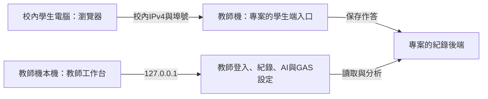

# 校內區網部署（學生端開給教室、教師端留在本機）

這套技能沿用「學生端開給教室、教師設定留在教師機」的範圍。區網設定在啟動時選擇，與教師頁的 API 金鑰／GAS 設定分開；沒有把教師設定頁改成遠端管理頁。

IPv4 與埠號**不寫死在本檔或技能裡**：由工作區根目錄的 `private/config/sites.local.json` 取值（鍵見 SKILL.md「設定」一節）。缺值就停下問使用者，不猜。



## 哪個程式可以開放

| 程式 | 區網能力 | 啟動方式 |
|---|---|---|
| 本技能的獨立教師範本 | 只有教師端，沒有學生編輯器；只在本機提供服務，埠號取 `local.teacher_port`（以 `PORT` 環境變數傳入） | `node server.mjs --demo` 或 `node server.mjs` |
| 已有學生端伺服器的 Node.js 教學程式 | 專案自己有學生入口、紀錄與求助入口；教師入口只在本機 | 下方 `start` 轉接器，或專案原本的啟動器 |
| 其他教學程式 | 需開發者接上學生入口與權限；設定檔不會自動改造程式 | 使用 `readConfig` 讀設定後整合原啟動器 |

工具只依賴既有 Node.js 22 以上，不安裝套件、不改防火牆、不開放所有網卡，也不替既有專案降低 RECORD_TOKEN 規則。

## 步驟

1. 教師機準備好**自己信任**的專案（轉接器會執行該資料夾的 Node 程式），並知道學生端伺服器的相對路徑（`--entry`）。學生電腦只需瀏覽器，不需裝 Node.js。
2. 先用專案原本的方式啟動，在教師機開教師頁建立教師密碼與 API 金鑰；GAS 是選用，沿用專案自己的規則。確認後停止原服務視窗再往下做。
3. 在本技能的 `assets/template/` 資料夾開 PowerShell，整段貼上（埠號用 `local.student_port` 的值）：

```powershell
node --version
node scripts/school-lan.mjs list
$schoolIp = Read-Host '請輸入清單中這台教師機的校內IPv4（可對照 local.lan_ipv4）'
$schoolPort = Read-Host '請輸入學生端埠號（local.student_port）'
node scripts/school-lan.mjs configure --ip $schoolIp --port $schoolPort
```

清單顯示「可選」才可用；IP 必須在本機網卡上。私人網段和學校公開網段均可明確選擇；公開格式不等於校外可連或已被防火牆保護，需資訊組核對。排除回送、鏈路本機、多播、保留位址與文件專用網段（192.0.2.0/24、198.51.100.0/24、203.0.113.0/24）、IPv6、VPN 與虛擬網卡；多網卡不自動猜。`configure` 只保存設定，成功後才做下一步；**沒有預設埠號**，沒給就拒絕。

4. 同一個範本視窗啟動專案的學生端伺服器：

```powershell
$project = Read-Host '請輸入專案資料夾的完整路徑'
$entry = Read-Host '請輸入學生端伺服器相對於專案的路徑，例如 server/student.mjs'
node scripts/school-lan.mjs start --project $project --entry $entry
```

可加 `--student-path /index.html`、`--teacher-path /teacher.html` 調整印出的網址。轉接器把 `TUTOR_LAN=1`、`TUTOR_LAN_IP` 與 `TUTOR_PORT` 傳給該入口，不複製專案密鑰、不改原始碼；入口必須是專案資料夾內的檔案。專案的伺服器要自己讀這三個環境變數並只綁定指定 IPv4。原服務仍須檢查教師設定／AI 金鑰、教師與學生路由、求助上限。以原服務「啟動成功」輸出為準；轉接器先印的網址只是準備啟動，若原服務拒絕不能算成功。

5. 服務成功後，將顯示的**學生網址**給校內另一台電腦；教師機自己開顯示的 `127.0.0.1` 教師網址。視窗保持開啟；Ctrl+C 停止。更新後端後先關舊服務再啟動；埠已使用代表新服務未啟動，不自動殺掉別的程式。

## 設定存在哪裡

預設是範本的 `local-data/school-lan.json`，含版本、`access: student-only`、`ip`、`port`、`interfaceName`，沒有 API 金鑰或 token。`.gitignore` 排除整個 local-data；不要提交本機 IP／網卡設定。

已有設定時 `configure` 拒絕覆寫。換學校／換 IP 後，先重新列清單確認，再使用另一份檔名；啟動時指定相同檔案：

```powershell
node scripts/school-lan.mjs list
node scripts/school-lan.mjs configure --ip <新的校內IPv4> --port <學生端埠號> --config local-data/school-lan-next.json
node scripts/school-lan.mjs start --project <專案資料夾> --entry <學生端入口> --config local-data/school-lan-next.json
```

若 school-lan-next.json 也存在，改用新的檔名，不必刪除舊設定。每次啟動都核對網卡名稱及 IP；位址消失或同位址換網卡就拒絕，不改用其他網路。

## 校內連線檢查

依序確認：教師機本機學生頁可開 → 校內第二台電腦可開學生網址 → 校內第二台開同 IP 的教師頁回403 → 假代號評分／求助在教師機出現紀錄 → 如用GAS，直接查看自己的試算表有新列。求助可先用模擬練習；不要為測通訊直接呼叫付費AI。

- 第二台連不上：先檢查服務仍開啟、目前 IP／埠、是否同校網路及無線用戶隔離。Windows 學生機可在 PowerShell 依序執行 `$teacherIp = Read-Host '請輸入教師機IPv4'`、`$teacherPort = Read-Host '請輸入埠號'`、`Test-NetConnection -ComputerName $teacherIp -Port $teacherPort`，確認 TcpTestSucceeded。
- 防火牆：請資訊組只允許必要 TCP 埠及授課電腦／班級網段，依實際網路設定檔設定；不要直接允許所有來源或關閉防火牆。網卡的遮罩不代表授課電腦允許範圍，工具不自行產生防火牆規則。
- 學校採公開 IPv4：用校外連線確認學生網址無法開啟；若校外能連，立即停止服務並請資訊組處理。單一網卡綁定不能阻止被路由到該位址的校外流量。
- 區網是 HTTP，學生作答會經校網傳輸；需限制在校內可信網路。不用路由器轉送埠、不開校外遠端。若要讓其他教師電腦登入工作台，須另行設計 HTTPS 與教師存取控制；不要把本機教師 `server.listen` 改成 `0.0.0.0`。

## 接入其他 Node.js 專案

複製工具至自己專案後，可從後端匯入 `readConfig(configPath)`：它會檢查設定格式、目前本機網卡、IP 和埠號。再由原專案把回傳的 `ip`、`port` 接到**學生專用伺服器**。不會自動掛上教師API、學生資料來源或TLS；不能把含教師路由的既有伺服器直接交給區網。

接線時維持兩個入口：本機教師端綁 `127.0.0.1`；學生端只綁選定 IPv4。學生端採路由白名單，禁止教師頁／教師登入／設定／紀錄讀取與同步；狀態只回必要布林值，不回密鑰或試算表網址。學生API檢查實際Host／Origin、限制請求大小與付費求助，禁止廣域CORS；靜態根目錄只選公開建置檔，不映射local-data。這些需要原專案實作與測試；本設定工具本身不提供路由保護。

技術依據：[Node.js 網卡清單](https://nodejs.org/docs/latest-v22.x/api/os.html#osnetworkinterfaces)、[Node.js 明確監聽位址](https://nodejs.org/docs/latest-v22.x/api/net.html#serverlistenport-host-backlog-callback)。省略host可能綁所有位址，所以接線須明確填入。
